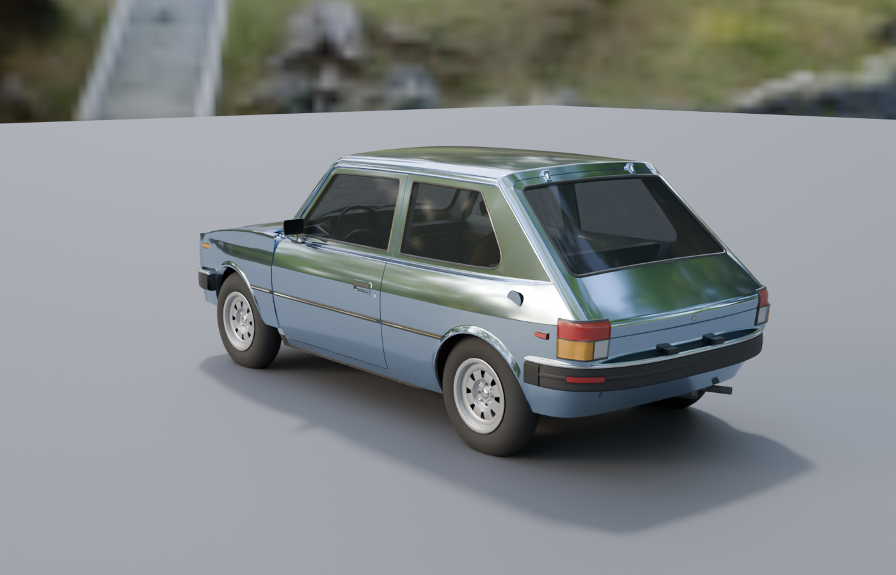

# Aria '83 Hatch – early-80s Japanese hatch restyle for the Autobello Aria

Restyles Kajzer's [1972 Autobello Aria](https://www.beamng.com/resources/1972-autobello-aria.35232/)
(v1.0.5) after a 1983 Honda Civic 3-door. It uses no Honda badges or names in game.




There are two ways to install it:
- **Standalone (no other mod needed):** `aria_83_hatch_standalone.zip` from the
  [Releases page](https://github.com/jacobkuzmits/beam-mods/releases). It contains the full Aria
  (credited, unmodified; the author allows reuploads with credit) plus this restyle. At ~157 MB it's
  too big to store in git, so it lives on the release.
- **Add-on (if you already have the Aria):** `dist/aria_83_hatch_addon.zip` (~2 MB).

## What's new
New config **Autobello Aria › '83 Hatch Sport (M)**: the late 120 Super with these parts.

| Part | Slot |
| --- | --- |
| Flat hood with louvred cowl vent, sitting between the fenders | Hood |
| Fenders rising flush to the hood (sharp shoulder into the door belt), squarer front corners, arch lips, amber side markers | Front fenders L/R |
| Front panel: body-colour bands above/below the grille and lower apron | Front panel |
| Chrome strip over the grille and chrome sill strip under lamps + grille | Front fascia |
| Black fine-bar grille (bottom flush with the lamps, top below them) with emblem | Grille |
| Rectangular sealed-beam headlights: chrome bezels, retaining rings, prism-fluted lenses, reflectors | Headlights L/R |
| Higher wraparound front bumper: bright top strip, rub rib, end caps, clear/amber lamps | Front bumper |
| Higher wraparound rear bumper with bright strip, red reflectors and plate-lamp housings; body-colour rear panel | Rear bumper |
| Rectangular corner taillights, nearly flush: dark gasket frame, red over clear/amber, prism-textured lenses over a mirror reflector (inner corner moves with the tailgate) | Taillights L/R |
| Black rub strips with chrome insert, rear side reflectors, round fuel door | Side trim |
| Raised rear plate (between the lamps) | Rear license plate |
| 13x5 silver steel wheels with center caps | Wheels |
| Sport-tuned exhaust sound (tuned I4 intake and exhaust samples, more overrun pops) | Exhaust (1.0/1.2 engines) |
| Light-blue metallic paint, no mudflaps or lettering, both mirrors | config |

New body-colour panels use the Aria's own body material, with UVs pinned to a fully painted texel, so
they take whatever paint the car has.

## Physics and stats
Every new part is a copy of the Aria part in the same slot. Nodes, beams, triangles, wheel physics,
couplers/latch controllers, light bulbs and the exhaust torque curve are unchanged, and a script
checks this (see `tools/package_h83.py`). Only meshes, light materials and engine sound differ. The
bumpers sit a few cm higher visually than the (unchanged) bumper nodes. The cosmetic extras removed
or added (mudflaps, lettering, front plate, right mirror) change weight by a kilo or two.

## Install
Put **one** of the zips in `<BeamNG user folder>/current/mods/`:
- the standalone zip *instead of* the Aria mod (remove or disable the Aria so the two copies don't clash), or
- the add-on zip *next to* the Aria mod.

## Rebuild
```
python3 -I tools/make_textures.py build/tex
blender-4.5 -b --factory-startup --python tools/build_h83.py -- \
    --aria <aria>/vehicles/ariahatch/ariahatch.dae --dae build/hatch83.dae --meta build/meta.json
python3 -I tools/package_h83.py --aria <aria>/vehicles --build build --out dist \
    [--thumb build/thumb.jpg] [--bundle <aria mod zip>]   # --bundle also writes the standalone zip
```
Use Blender 4.5 LTS or older (5.x has no COLLADA). Geometry lives in `tools/h83_geom.py`. Its shape
tables come from raycasts of the Aria (`tools/probe_*.py`) and from the reference photos below,
overlaid at true scale on orthographic renders. The shared helpers (`../tools/jbeam.py` config
resolver, `../tools/preview_vehicle.py` Cycles preview with ortho views) render the comparison shots.

## Credits
- Original vehicle, jbeam and physics: **Kajzer** (Autobello Aria).
- Reference photos (Wikimedia Commons), used only as modelling reference:
  [1982 Civic 3-door, front](https://commons.wikimedia.org/wiki/File:1982_Honda_Civic_3-door_hatchback_(2015-07-10)_01.jpg)
  and [rear](https://commons.wikimedia.org/wiki/File:1982_Honda_Civic_3-door_hatchback_(2015-07-10)_03.jpg) (public domain);
  [1982 Civic 1.3, front](https://commons.wikimedia.org/wiki/File:1982_Honda_Civic_second_gen_1.3_hondamatic-_31_years_old!_(9689939733).jpg)
  and [rear](https://commons.wikimedia.org/wiki/File:1982_Honda_Civic_second_generation_hondamatic_1.3_(9693141812).jpg) (CC BY 2.0);
  [2nd-gen Civic hatchback, profile](https://commons.wikimedia.org/wiki/File:Honda_Civic_(hatchback)_Second_Generation.jpg) (CC BY-SA 4.0).
- Restyle meshes, part setup and sound tune: this add-on.
