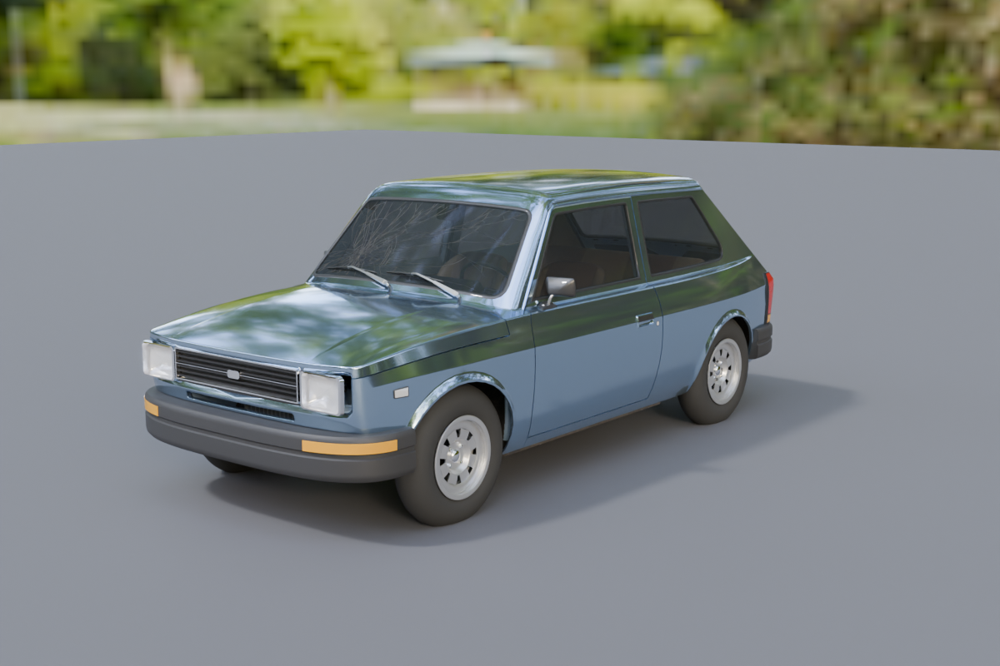

# Aria '83 Hatch – early-80s Japanese hatch restyle for the Autobello Aria

An add-on for Kajzer's [1972 Autobello Aria](https://www.beamng.com/resources/1972-autobello-aria.35232/)
(v1.0.5) that restyles the late Aria after a 1983 Honda Civic 3-door. It uses no Honda badges or names
in game.




There are two ways to install it:
- **Standalone (no other mod needed):** `aria_83_hatch_standalone.zip` from the
  [Releases page](https://github.com/jacobkuzmits/beam-mods/releases). It contains the full Aria
  (credited, unmodified; the author allows reuploads with credit) plus this restyle. At ~156 MB it's
  too big to store in git, so it lives on the release.
- **Add-on (if you already have the Aria):** `dist/aria_83_hatch_addon.zip` (0.75 MB).

## What's new
New config **Autobello Aria › '83 Hatch Sport (M)**: the late 120 Super with these parts.

| Part | Slot |
| --- | --- |
| Sealed-beam headlights with chrome bezels | Late headlights L/R |
| Black slat grille with chrome surround and emblem | Late grille |
| Wraparound black front bumper with amber corner signals | Front bumper |
| Wraparound black rear bumper | Rear bumper |
| Wraparound corner taillights (red / amber / reverse) | Taillights L/R |
| 13x5 silver steel wheels with center caps | Wheels |
| Sport-tuned exhaust sound (tuned I4 intake and exhaust samples, more overrun pops) | Exhaust (1.0/1.2 engines) |
| Light-blue metallic paint, no mudflaps or lettering, both mirrors | config |

The parts can also be fitted to other late Aria configs from the parts menu.

## Physics and stats
Every new part is a copy of the Aria part in the same slot. Nodes, beams, triangles, wheel physics,
light bulbs and the exhaust torque curve are unchanged, and a script checks this
(see `tools/package_h83.py`). Only meshes, light materials and engine sound differ. The config's
tuning values match the 120 Super. The cosmetic extras removed or added (mudflaps, lettering, front plate,
right mirror) change weight by a kilo or two.

## Install
Put **one** of the zips in `<BeamNG user folder>/current/mods/`:
- the standalone zip *instead of* the Aria mod (remove or disable the Aria so the two copies don't clash), or
- the add-on zip *next to* the Aria mod.

## Rebuild
```
blender-4.5 -b --factory-startup --python tools/build_h83.py -- \
    --aria <aria>/vehicles/ariahatch/ariahatch.dae --dae build/hatch83.dae --meta build/meta.json
python3 -I tools/package_h83.py --aria <aria>/vehicles --build build --out dist \
    [--thumb build/thumb.jpg] [--bundle <aria mod zip>]   # --bundle also writes the standalone zip
```
Use Blender 4.5 LTS or older (5.x has no COLLADA). Geometry lives in `tools/h83_geom.py`. The shared
helpers (`../tools/jbeam.py` config resolver, `../tools/preview_vehicle.py` Cycles preview) also
render the comparison shots.

## Credits
Original vehicle, jbeam and physics: **Kajzer** (Autobello Aria). Restyle meshes, part setup and sound
tune: this add-on.
