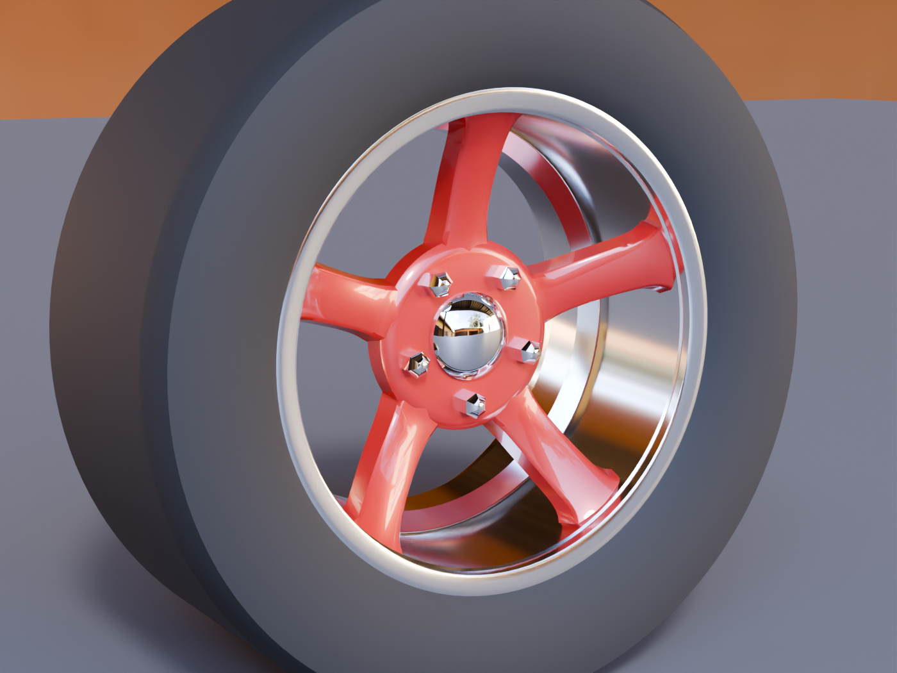
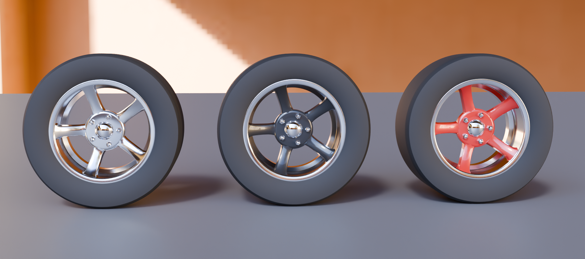

# Kestrel K5 – vintage 5-spoke wheel for "vintage parts & livery pack——wheels pack"

An original, procedurally modelled wheel added to saaaalleeeeeenn's BeamNG wheel pack (v fixed1.5).




- 7 sizes: 15x8, 15x9, 15x10, 16x8, 18x8, 18x9, 18x10, front and rear (`wheel_F_5` / `wheel_R_5`)
- 3 finishes: Polished, Black (polished lip), Colorable (uses the car's paint, polished lip)
- Mesh placement and physics values match the pack's CN505 parts for each size, so it mounts the same way.

## Install
Put [`dist/vintage_wheels_kestrel_k5_addon.zip`](dist/vintage_wheels_kestrel_k5_addon.zip) in `<BeamNG user folder>/current/mods/`. It's a standalone mod: it uses only vanilla tires and doesn't need the original pack installed.

In game: Vehicle Config → Wheels → "Kestrel K5 Vintage 5-Spoke …"

## Rebuild
```
blender-4.5 -b --factory-startup --python tools/build_blend.py -- --dae build/kestrel_k5.dae \
    [--renders build/renders --hdri <studiolight.exr>]
python3 -I tools/package.py --cn505 <pack>/vehicles/common/wheels/wheels_5lug/cn505 \
    --dae build/kestrel_k5.dae --out dist
```
Use Blender 4.5 LTS or older. Blender 5.x removed COLLADA export. Shape parameters are in `tools/k5_mesh.py`.
